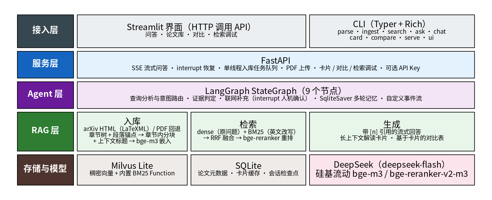
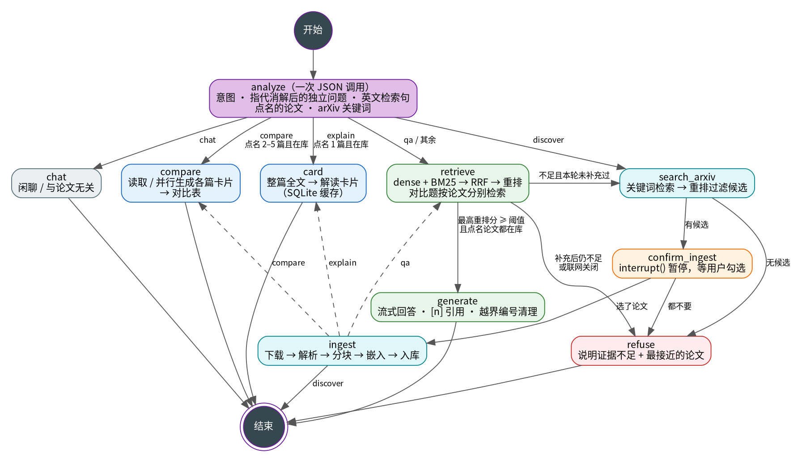
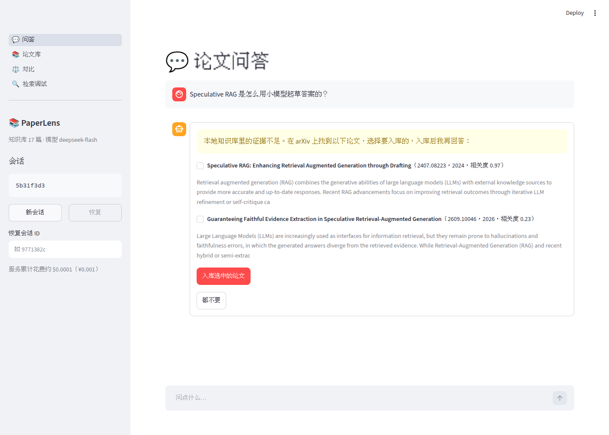
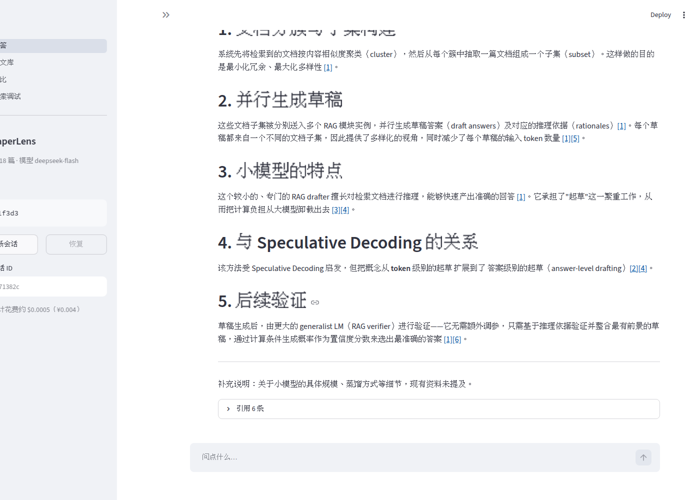
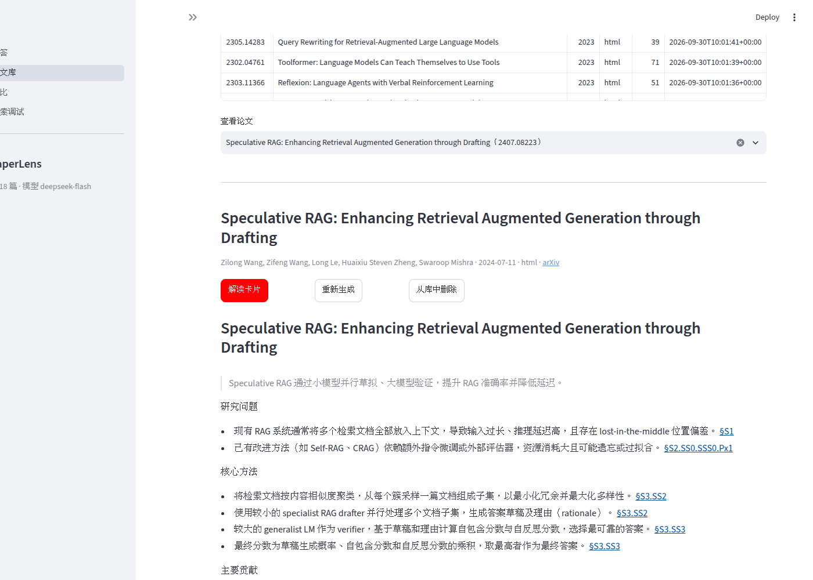
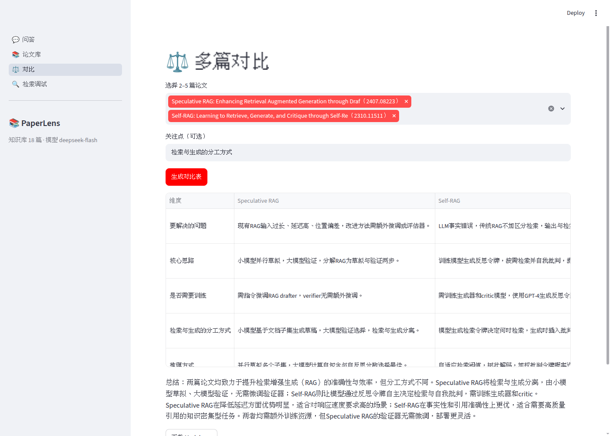
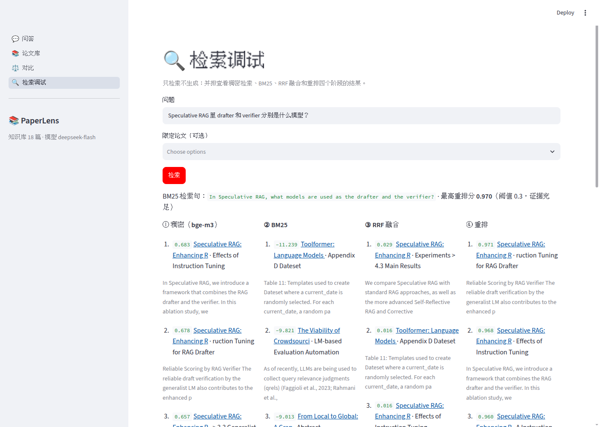

# PaperLens 项目讲解

PaperLens 是一个本地运行的论文知识库助手。把 arXiv 论文或自己的 PDF 放进知识库后，可以用中文或英文提问，回答里的每条结论都带 `[n]` 引用，点击能跳到 arXiv 原文的对应段落。它还能为单篇论文生成解读卡片、为多篇论文生成对比表。本地库找不到答案时，它会去 arXiv 找相关论文，经你确认后入库再回答。

技术栈：Python 3.12 · LangGraph · Milvus Lite · FastAPI（SSE）· Streamlit · DeepSeek · bge-m3 / bge-reranker-v2-m3 · SQLite · Typer · pytest

---

## 1. 功能一览

| 功能 | 用户看到什么 | 关键技术 |
|---|---|---|
| 论文入库 | 输入 arXiv ID / 关键词 / 上传 PDF，自动解析入库；重复入库自动跳过 | arXiv API、LaTeXML HTML 解析、PDF 回退、章节内分块 |
| 带引用问答 | 中文提问检索英文论文，回答逐条标 `[n]`，链接跳到原文段落 | 稠密 + BM25 混合检索、RRF、cross-encoder 重排、引用校验 |
| 多轮对话 | 「它在哪些数据集上做了实验？」能理解「它」指上一轮的论文 | LLM 查询改写、LangGraph `SqliteSaver` 会话持久化 |
| 证据不足时联网补充 | 本地答不了时列出 arXiv 候选论文，勾选后入库并重新回答 | 证据判定、`interrupt()` 人机确认、候选论文重排过滤 |
| 解读卡片 | 研究问题 / 方法 / 贡献 / 实验 / 结果 / 局限，每条标出处章节 | 整篇全文长上下文 + JSON 结构化抽取、锚点校验、缓存 |
| 多篇对比 | 2–5 篇论文生成对比表，可指定关注点 | 基于卡片的二次结构化生成、并行生成缺失卡片 |
| 检索调试 | 并排查看稠密 / BM25 / RRF / 重排四个阶段的结果和分数 | `explain` 模式 |
| Web 与 CLI | 浏览器四个页面；命令行 11 个子命令 | FastAPI + SSE、Streamlit、Typer + Rich |

---

## 2. 快速上手

```bash
cd paperlens
uv sync                                        # 按 uv.lock 安装锁定版本的依赖
cp .env.example .env                           # 填 LLM_API_KEY（DeepSeek）和 SILICONFLOW_API_KEY
uv run paperlens doctor                        # 自检：配置、LLM、Embedding、Rerank、arXiv 连通性
uv run paperlens ingest -f eval/seed_papers.txt  # 入库 15 篇 RAG / Agent 经典论文，约 2 分钟
```

命令行使用：

```bash
uv run paperlens ask "Self-RAG 的反思 token 有哪几种？"   # 单轮带引用问答
uv run paperlens chat                                   # 多轮对话 Agent
uv run paperlens card Self-RAG                          # 解读卡片（支持 ID 或标题简称）
uv run paperlens compare Self-RAG CRAG FLARE --focus "何时触发检索"
uv run paperlens search "混合检索中 BM25 的作用" --explain  # 查看检索各阶段
```

Web 界面（两个终端）：

```bash
uv run paperlens serve     # API：http://127.0.0.1:8000，接口文档在 /docs
uv run paperlens ui        # 界面：http://127.0.0.1:8501
```

---

## 3. 架构



**五层结构**

- **接入层**：Streamlit 界面和 CLI。界面只通过 HTTP 调用 API，不直接碰存储。
- **服务层**：FastAPI。负责 SSE 流式问答、人机确认的恢复、后台入库任务队列、PDF 上传、卡片 / 对比 / 检索调试接口。
- **Agent 层**：LangGraph 状态图，负责意图路由、证据判定、联网补充和多轮记忆。
- **RAG 层**：入库（解析、分块、嵌入）、检索（混合检索 + 重排）、生成（带引用回答、卡片、对比表）。
- **存储与模型**：Milvus Lite 存向量和 BM25 索引，SQLite 存元数据、卡片缓存和会话检查点。模型都走 HTTP 接口。

**进程模型**：Milvus Lite 的一个库文件只能被一个进程打开（实测）。所以 Web 模式下 FastAPI 是唯一持有存储的进程，Streamlit 通过 HTTP 调用它。CLI 在服务没启动时直接操作存储。

**代码组织**（src 约 4.8k 行，测试约 1.5k 行）

```
src/paperlens/
├── config.py / services.py / cli.py / doctor.py   # 配置、依赖组装、命令行、环境自检
├── models/    # LLM 客户端（流式、JSON 模式重试）、Embedding / Rerank、token 与费用统计
├── ingest/    # arxiv_client、html_parser、pdf_parser、chunker、pipeline
├── store/     # db.py（SQLite）、vectors.py（Milvus 混合检索）
├── rag/       # query（查询分析）、retriever、answer（带引用生成）、card、compare
├── agent/     # state.py、graph.py（LangGraph 状态图）
├── api/       # app.py（FastAPI）、client.py（HTTP 客户端）
└── ui/        # app.py（Streamlit）
```

`Services` 类用 `cached_property` 懒加载数据库、向量库和模型客户端，CLI、Agent 和 API 共用这一套，测试时整体替换成替身。

---

## 4. 核心流程

### 4.1 入库：从 arXiv 到可检索的分块

```
arXiv API 取元数据 → 下载 HTML（LaTeXML 生成）→ 解析章节树与段落锚点
                     └─ 没有 HTML 或内容太少 → 下载 PDF → pymupdf4llm 按页解析
→ 章节内分块 + 上下文标题 → bge-m3 嵌入 → Milvus（向量 + BM25）+ SQLite（元数据）
```

- **优先用 HTML**：arXiv 的 HTML 版带完整的章节结构，每个段落都有稳定的 id（如 `S3.SS2.p4`）。引用因此能精确到段落，PDF 只能精确到页。
  - 公式保留为 `$LaTeX$`。
  - 表格转成 Markdown 表格并单独成块。
  - 参考文献和致谢直接丢弃。
- **解析时修掉的坑**：
  - 有的论文用 TikZ 画图，LaTeXML 会把 2 万多字符的绘图命令塞进公式的 alttext，这类公式替换成 `[formula]`。
  - PDF 的页眉页脚按「出现在一半以上页面」识别后去掉。
  - PDF 的章节层级按编号推断，「3.2」挂在「3」下面。
- **分块策略**：
  - 同一章节内的段落合并到约 400 token（上限 600），不跨章节，表格和图注单独成块。
  - 每块前面加上下文标题 `论文标题 | 章节路径` 再做嵌入和 BM25 索引，这样「Table 3 的结果」这类孤立段落也知道自己属于哪篇论文的哪一节。
- **幂等**：以 arXiv 基础 ID 为主键。已入库且版本相同就跳过；发现新版本时先删旧块再入库。批量入库时单篇失败不影响其他论文。

### 4.2 检索：混合检索 + 重排

```
问题 ──(原问题，bge-m3)──→ 稠密检索 Top 30 ┐
     └─(LLM 改写的英文检索句)─→ BM25 Top 30 ┴→ RRF 融合（k=60）Top 20 → bge-reranker 重排 → Top 6
```

- **一个库完成混合检索**：Milvus 2.5+ 内置 BM25 Function，插入文本时自动生成稀疏向量。`hybrid_search` + `RRFRanker` 一次调用完成两路检索和融合，不需要再维护一个 Elasticsearch。
- **跨语言**：知识库是英文论文，用户常用中文提问。
  - 稠密通道直接用中文原问题，bge-m3 是多语言模型，可以跨语言匹配。
  - BM25 是词面匹配，中文词匹配不到英文原文，所以 BM25 通道用 LLM 生成的英文检索句。
  - 英文检索句和意图识别、指代消解在同一次 JSON 调用里完成，不额外增加延迟。
- **限定范围**：问题里点名了论文（「Self-RAG 的……」）时，按标题解析成 paper_id，检索只在这几篇里做。
  - 匹配规则依次是精确 ID、标题冒号前的系统名、首字母缩写（CRAG → Corrective Retrieval Augmented Generation）、子串。
- **对比类问题**：在每篇论文内部分别检索，保证每篇都有证据，不会被其中一篇的段落占满。

### 4.3 生成：带引用的回答

- 证据按 `[1]…[6]` 编号放进 `<evidence>` 标签。系统提示要求每个事实性陈述后标编号，证据没覆盖的内容回答「现有资料未提及」。
- **防提示注入**：提示里声明证据是外部资料，其中出现的任何指令都不执行。
- **引用校验**：生成结束后检查引用编号。越界的编号（比如只有 6 条证据却标了 `[9]`）直接从回答里删掉，结果随回答返回。
- 回答流式输出。CLI 逐字打印，Web 端通过 SSE 逐字渲染，最后把 `[n]` 渲染成指向 `https://arxiv.org/html/{id}{version}#{段落锚点}` 的链接。

### 4.4 Agent：LangGraph 状态图



| 节点 | 作用 |
|---|---|
| analyze | 一次 JSON 调用输出：意图（qa / explain / compare / discover / chat）、消解指代后的独立问题、英文检索句、点名的论文、arXiv 关键词 |
| chat | 闲聊或与论文无关的问题，简短回答 |
| retrieve | 混合检索 + 重排 |
| generate | 流式生成带引用的回答 |
| card / compare | 解读卡片 / 对比表（点名的论文都在库里时走这两条路） |
| search_arxiv | 去 arXiv 检索，用 reranker 按「问题 vs 标题 + 摘要」打分过滤候选 |
| confirm_ingest | `interrupt()` 暂停图的执行，把候选列表交给用户勾选 |
| ingest | 入库用户选中的论文，然后按原意图回到 retrieve / card / compare |
| refuse | 证据不足时如实说明，并列出相关度最高的几篇论文 |

几个关键设计：

- **证据判定**：重排最高分 ≥ 0.3，并且点名的论文都在库里，才算证据充足。点名的论文不在库里时，即使全库检索分数不低也去联网补充，避免拿别的论文的内容冒充。
- **联网补充最多一轮**：`supplemented` 标记防止循环。补充后仍不足就拒答。`ONLINE_FALLBACK=off` 时直接拒答，用于无人值守的场景。
- **候选论文过滤**：arXiv 的关键词检索噪声很大，实测搜 "FLARE" 排第一的是一篇联邦学习论文。用 reranker 打分后过滤掉低于 0.05 的候选，实测只剩下正确的那一篇（0.99）。
- **多轮记忆**：`SqliteSaver` 按 `thread_id` 持久化整个状态，进程重启后会话照样能接着聊，Web 端刷新页面也能恢复到「等待确认」的状态。送进模型的历史保留最近 6 轮，助手的长回答截断到 400 字，只用于指代消解。
- **状态只存 JSON 友好的类型**：除消息外，状态里都是 dict / list / str，检查点的序列化不依赖自定义类。
- **事件流**：节点通过 `get_stream_writer()` 写出 `status / token / citations / card / compare / message` 事件，图暂停时产出 `interrupt` 事件。CLI 和 API 消费的是同一套事件。

**为什么用状态图而不是自由 ReAct**：问答路径基本是固定的，写成状态图后延迟和成本可以预期，每个节点也能单独测试。只有「证据够不够、要不要联网」这一处需要判断，用条件边表达就够了。

### 4.5 解读卡片与多篇对比

- **单篇用长上下文，跨论文用 RAG**：
  - 库里论文全文大多 5k–19k token（含附录），直接整篇送进模型，按固定字段抽取。
  - 这样不会像检索那样漏掉分散在各章节的信息，例如实验设置一部分在正文、一部分在附录。
  - 一张卡片约 18k 输入 token，约 ¥0.02，生成后缓存到 SQLite 的 `cards` 表。
- **出处校验**：每条要点要求填出处章节的锚点（全文里以 `## 章节名 [#S3.SS2]` 的形式提供）。模型写的锚点不在原文里时清空，不生成指向不存在位置的链接。
- **对比基于卡片**：先取各篇卡片（缺的用线程池并行生成），再把卡片送进模型生成对比表。5 篇卡片加起来只有几千 token，比塞 5 篇全文便宜得多，维度也更整齐。模型漏写的单元格补「未提及」，多写的丢弃，保证表格对齐。

### 4.6 Web 服务

| 方法 | 路径 | 说明 |
|---|---|---|
| POST | `/chat` | SSE 流式问答，事件见 4.4，最后一个事件是 `done` |
| POST | `/chat/{thread_id}/resume` | 回应联网补充的确认 |
| GET | `/chat/{thread_id}` | 会话历史与待确认的操作 |
| GET / DELETE | `/papers`、`/papers/{id}` | 论文列表、详情、删除 |
| GET | `/papers/{id}/card` | 解读卡片（`?refresh=true` 重新生成） |
| POST | `/compare` | 多篇对比 |
| POST | `/papers/ingest`、`/papers/upload` | 按 arXiv ID 入库、上传 PDF（后台任务，返回 202） |
| GET | `/jobs`、`/jobs/{id}` | 入库任务进度 |
| GET | `/arxiv/search` | 在 arXiv 上搜论文（不入库） |
| POST | `/search` | 检索调试，返回四个阶段的结果 |

- **问答在后台线程里跑**：
  - 通过队列把事件转成 SSE。客户端中途断开，Agent 也会跑完，会话检查点保持完整。
  - 同一会话同时只允许一个请求，重复请求返回 409。
- **入库任务串行执行**：用单线程任务队列，一是 arXiv 要求请求间隔 3 秒，二是 Milvus 写入不需要并发。前端每 3 秒轮询一次进度。
- **安全**：
  - 默认只监听 127.0.0.1、不鉴权。
  - 设置 `API_KEY` 后所有接口（健康检查除外）都要带 `X-API-Key`，用 `secrets.compare_digest` 比较。
  - 监听非本机地址却没设 Key 时，启动会打印警告。
  - 上传文件校验 `%PDF` 文件头和大小上限（默认 50 MB），文件名去掉路径并清理特殊字符。
  - 请求体用 Pydantic 校验长度和格式（如 thread_id 只允许字母、数字、下划线和连字符）。
  - SQLite 全部参数化查询，Milvus 过滤表达式里的字符串用 JSON 转义。

---

## 5. 使用案例

以下输出都来自真实运行（知识库 18 篇论文、1064 个块）。

### 案例 1：中文提问，带引用回答

```
$ paperlens ask "Self-RAG 的反思 token 有哪几种？分别起什么作用？"
英文检索句：What are the reflection tokens in Self-RAG and what are their respective roles?；限定论文：2310.11511

Self-RAG 的反思 token 分为 retrieval token 和 critique token 两大类 [1]，具体共四种类型（Table 1）[2]：
| 类型 | 输入 | 输出取值 | 作用 |
| Retrieve | x / x,y | {yes, no, continue} | 决定何时需要用检索器进行检索 [2] |
| IsRel | x,d | {relevant, irrelevant} | 判断检索到的段落是否有用 [2] |
……
引用
[1] Self-RAG … · 1 Introduction            https://arxiv.org/html/2310.11511v1#S1.p1
[2] Self-RAG … · 3.1 Problem Formalization  https://arxiv.org/html/2310.11511v1#S3.T1
合计约 ¥0.0035，耗时约 6 秒
```

查询分析识别出问题点名了 Self-RAG，检索只在这一篇里做。`[2]` 直接链接到原文的 Table 1。

### 案例 2：多轮追问

```
你：Self-RAG 的反思 token 有哪几种？
PaperLens：……
你：那它的 critic 模型是怎么训练的？
· 分析问题：意图 qa · 改写为：Self-RAG 的 critic 模型是怎么训练的？ · 提到的论文：Self-RAG
· 检索（限定 1 篇论文）：6 条证据，最高重排分 1.00
PaperLens：Self-RAG 采用用 GPT-4 生成 reflection token，再蒸馏到自建 critic 模型的方式 [5] ……
```

「它」被改写成 Self-RAG。会话存在 SQLite 里，`paperlens chat -t <会话ID>` 或在 Web 端输入会话 ID 都能接着聊。

### 案例 3：本地没有的论文，联网补充

在 Web 端问「Speculative RAG 是怎么用小模型起草答案的？」，库里没有这篇论文：



Agent 在 arXiv 上找到 2 篇候选，重排分 0.97 的就是原论文。勾选后后台入库（72 个块），然后重新检索并回答，引用链接直接指向新论文的段落：



### 案例 4：解读卡片

```
$ paperlens card ReAct
通读全文生成卡片：ReAct: Synergizing Reasoning and Acting in Language Models
> ReAct 让语言模型交替生成推理轨迹与动作，在问答、事实验证和交互决策任务上超越单独推理或行动的方法。
研究问题
 • 纯推理方法（CoT）是静态黑箱，不接地于外部世界，容易产生事实幻觉和错误传播。 §S1
关键结果
 • 在 ALFWorld 上，ReAct 最佳试验平均成功率达 71%，显著优于 Act（45%）和 BUTLER（37%）。 §S4.SS0.SSS0.Px3
局限
 • （推断）ReAct 依赖外部环境（如 Wikipedia API）的检索质量……
```

在对话里说「讲讲 ReAct 这篇论文」也会走到这里。卡片生成一次约 9 秒，之后读缓存。Web 端在「论文库」页选中论文就能查看：



### 案例 5：多篇对比

```
$ paperlens compare Self-RAG CRAG 2305.06983 --focus "何时检索、如何处理检索质量"
```

| 维度 | Self-RAG | CRAG | FLARE |
|---|---|---|---|
| 何时检索 | 生成检索令牌决定是否检索，自适应阈值控制频率 | 检索后评估置信度，触发纠正动作 | 生成中低置信度 token 触发检索，迭代进行 |
| 如何处理检索质量 | 用批判令牌评估相关性、支持度和有用性 | 轻量评估器打分，分三档精炼、丢弃并搜索、结合 | 未提及对检索文档质量的显式评估 |
| 是否需要训练 | 需要训练生成器和批判模型 | 需要微调检索评估器，生成器即插即用 | 无需额外训练 |

其中两篇需要先生成卡片（并行），总耗时约 13 秒、¥0.04。卡片都已缓存时，对比约 4 秒。Web 端的对比页：



### 案例 6：检索调试

`paperlens search "..." --explain` 或 Web 端「检索调试」页，并排显示四个阶段的结果。可以直观看到 BM25 怎么用英文检索句召回关键词精确命中的段落，以及重排怎么把真正回答问题的段落提到前面：



---

## 6. 设计取舍

| 决定 | 理由 |
|---|---|
| HTML 优先，PDF 回退 | HTML 有章节结构和段落 id，引用能精确到段落；PDF 只能到页。老论文（如 2017 年的 Transformer）也有 HTML 版 |
| BM25 用 Milvus 内置 Function | 向量和全文索引在同一个库里，插入一次，不需要在两个存储之间双写和保持一致 |
| 稠密用原问题、BM25 用英文改写 | 各取所长：多语言嵌入天然跨语言，词面匹配需要同语言 |
| 单篇卡片用长上下文 | 单篇全文 1–2 万 token，整篇读比检索片段更完整；结果可缓存，重复看不再花钱 |
| 对比基于卡片而不是全文 | 输入从 5 万 + token 降到几千 token，维度也更整齐 |
| 状态图而不是自由 Agent | 路径固定、成本可预期、节点可单测；只在证据判定处分支 |
| 联网补充需要人确认 | 入库会写知识库，也会花时间，交给用户决定；无人值守时可以关闭 |
| 不用 ORM、不用 Docker | 只有两张表，标准库 sqlite3 足够；单机本地工具，`uv sync` 一条命令装好 |

---

## 7. 工程质量

- **测试**：
  - 96 个单元测试，约 10 秒跑完，模型、arXiv、网络全部用替身。
  - 覆盖：HTML / PDF 解析、分块、arXiv 客户端（MockTransport）、SQLite 和 Milvus Lite 存储、引用校验、Agent 路由的每条分支、卡片与对比、API 的每个接口和鉴权、上传校验。
  - 测试里修掉的坑：pymilvus 在 import 时会调用 `load_dotenv()`，把 `.env` 写进环境变量，导致测试误连真实接口。conftest 里用 autouse fixture 清掉相关环境变量。
- **代码规范**：ruff lint + format。依赖全部锁定版本（`uv.lock`）。
- **可观测**：每次模型调用都记录 token 和费用（区分 DeepSeek 高峰 / 非高峰价、缓存命中），CLI 结束时打印用量表，Web 侧栏显示累计花费。
- **容错**：
  - LLM 的 JSON 模式偶尔返回空内容，自动重试；结果不符合 Schema 时把错误发回模型修正。
  - Embedding / Rerank 和 arXiv 请求在网络错误、429、5xx 时指数退避重试。
  - 查询分析失败时按普通问题处理，节点异常转成一条消息返回，不中断对话。
- **成本**：一次问答约 ¥0.003–0.008，一张卡片约 ¥0.02，Embedding 和 Rerank 免费。入库 15 篇论文只花嵌入的钱，也就是 0 元。

- **评估**：30 篇论文、50 题自建测试集，A0–A4 检索消融和端到端问答，详见下一节和 [eval/reports/report.md](../eval/reports/report.md)。

---

## 8. 评估

| 配置 | Hit@5 | Recall@5 | MRR@10 | 延迟 p50 |
|---|---|---|---|---|
| A0 仅稠密检索，无上下文标题 | 87.5% | 65.0% | 0.749 | 0.21s |
| A1 + 上下文标题 | 90.0% | 69.0% | 0.817 | 0.20s |
| A2 + BM25（英文检索句）+ RRF | 90.0% | 71.8% | 0.874 | 0.22s |
| A3 + bge-reranker 重排（完整检索） | 100.0% | 84.0% | 0.967 | 0.65s |
| A4 = A3，但 BM25 用原问题 | 97.5% | 80.2% | 0.958 | 0.66s |

- 每一步都有收益：上下文标题让 Recall@5 +4 个点；BM25 + RRF 主要提升排序（MRR 0.817 → 0.874）；重排的提升最大（Recall@5 +12 个点），代价是每次多 0.45 秒。
- 英文检索句的作用：BM25 改用中文原问题（A4）后，中文题 Hit@5 从 100% 降到 95.5%，术语题从 100% 降到 90%。
- 端到端（`paperlens ask` 的路径）：可回答题正确率 95.0%，引用编号合法率 100%，延迟 p50 2.8 秒，单题约 $0.0004。
  10 道语料外的问题，8 道被证据判定拒答，另 2 道通过了判定，但回答开头都说明了“现有资料未提及”。
- 评估时发现了一个 bug：问题里说“RAG 论文”时，名称解析按子串命中了 “Leve**rag**ing Passage Retrieval…”，检索被限定在错误的论文里。
  修复后（子串必须从单词开头匹配，匹配到多篇时视为泛称），端到端正确率从 92.5% 升到 95.0%。
- 测试集的做法：LLM 依据随机抽取的块出题，人工逐题核对答案并改写了 10 道题；相关块用池化标注（五个配置 top-10 的并集交给 LLM 判定）。
  Recall 只在被池化的块里计算，是相对值，适合比较配置，不代表绝对召回率。

---

## 9. 已知限制

- Milvus Lite 单进程：`serve` 运行时不能同时用 CLI 跑 `ingest`。需要时可以改用 Milvus Standalone，代码只需改连接地址。
- PDF 来源的引用只能定位到页码，本地上传的 PDF 没有在线链接。
- 证据阈值 0.3 在测试集上看偏保守：0.1–0.2 时判定准确率 96%，0.3 时 94%（多误拒 1 道可回答题）。测试集只有 50 题，暂未调整默认值。
- 论文名称解析靠标题匹配：用户说的简称不出现在标题里时（如 “Fusion-in-Decoder”）解析不到，只能全库检索。
- 只理解文本、表格和图注，不理解图片内容。
- 知识库定位在几十到几百篇论文，没有为大规模语料做优化。

---

*ClawsGO Science Agent，2026-10-03；评估部分 2026-10-07*
